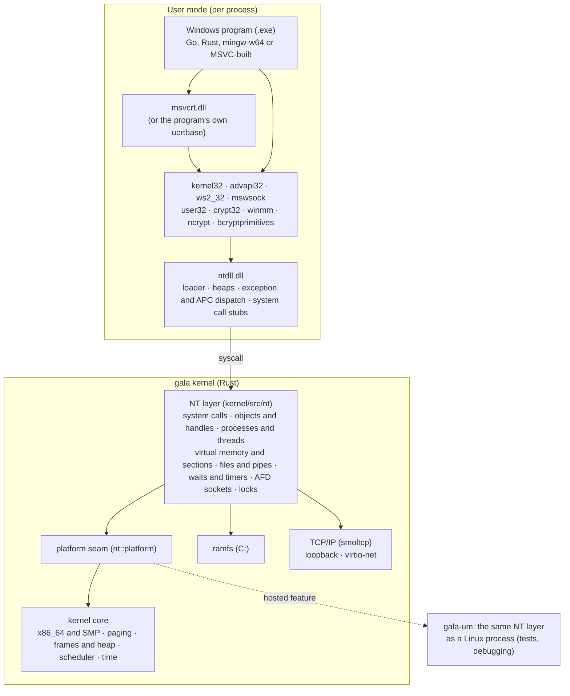
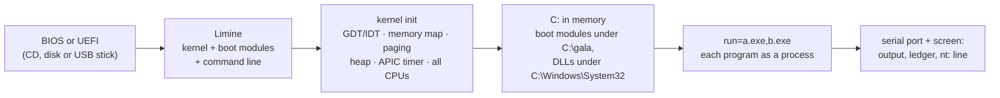
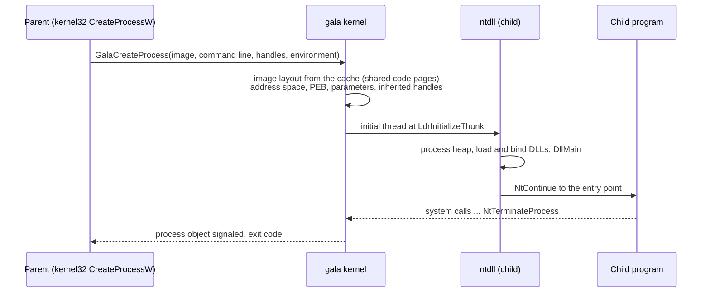
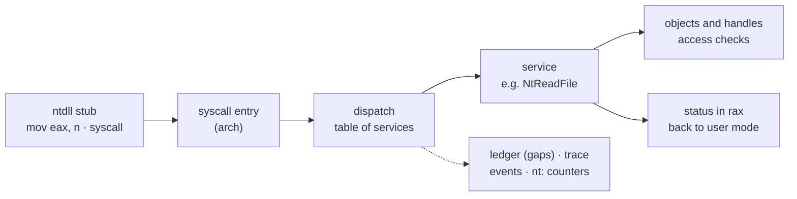
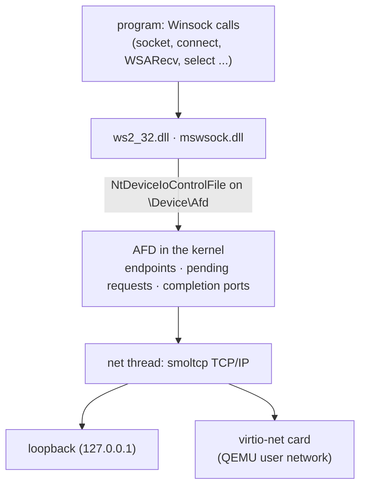
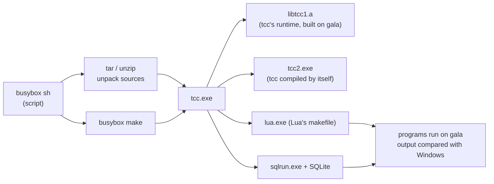
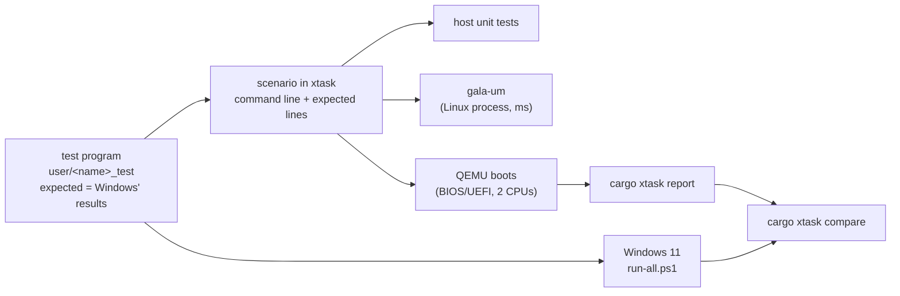

# gala-os


A from-scratch x86_64 kernel in Rust that runs unmodified 64-bit Windows
programs. It implements the Windows NT kernel's system call interface
(the "NT layer"), and ships its own clean-room ntdll.dll, kernel32.dll,
msvcrt.dll, ws2_32.dll and other system DLLs, so that `.exe` files built
for Windows - by MSVC-style toolchains, mingw-w64, Go or Rust - run on it
as they are.

The source is public so that it can be read; it is not open source. No
license is granted (see [License](#license) below).

It is written clean-room: from public documentation, headers, open-source
reimplementations and black-box behaviour of Windows only, never from
disassembly, decompiled code or leaked source
([`docs/CLEAN_ROOM.md`](docs/CLEAN_ROOM.md)). Every feature starts from a
test program whose expected results are those of real Windows (Windows 11
24H2, build 26100).

- Goals and rules: [`docs/PROJECT_BRIEF.md`](docs/PROJECT_BRIEF.md)
- Status and plan: [`docs/ROADMAP.md`](docs/ROADMAP.md)
- Design: [`docs/ARCHITECTURE.md`](docs/ARCHITECTURE.md)
- How work is done, pitfalls, tools: [`docs/WORKFLOW.md`](docs/WORKFLOW.md)
- Performance measurements: [`docs/PERF.md`](docs/PERF.md)
- gala-um (the NT layer as a Linux process): [`docs/GALA_UM.md`](docs/GALA_UM.md)
- Third-party code and provenance: [`THIRD_PARTY.md`](THIRD_PARTY.md)

## What runs on gala

Everything below is checked by a boot scenario (`cargo xtask test`; the
scenario names are in parentheses) that boots gala in QEMU, runs the
program and compares its output with what Windows gives.

### Real programs

| Program | What it does on gala | Scenarios |
|---|---|---|
| **Go** (1.24) | hello world, 1000 goroutines with channels and mutexes, timers and tickers, garbage collection over 200 MB, files and directories, exit codes, `os/exec` running child processes through pipes | `go_hello`, `go_goroutines`, `go_time`, `go_gc`, `go_os`, `go_exit`, `go_exec` |
| **Go net/http** | an HTTP server answering the host's requests over a virtio network card | `go_http` |
| **Nginx** 1.30.6 | serves its start page; master and worker processes; HTTPS with OpenSSL 3.5 | `nginx`, `nginx_master`, `nginx_tls` |
| **busybox-w32** (sh and its tools) | pipelines and `$(...)`, shell scripts from files (functions, loops, here-documents), file tools (`ls`, `find`, `grep -r`, `tar`, `md5sum`, `cp -r`, ...), background jobs, `unzip`, `make` | `busybox`, `busybox_script`, `busybox_files`, `tcc_make` |
| **TinyCC** (a C compiler) | compiles C programs on gala, builds its own runtime library, compiles **itself** into a second compiler that works the same | `tcc`, `tcc_self` |
| **make** | busybox's make builds a multi-file C project with tcc, rebuilds only what a changed file needs, stops at a failing rule | `tcc_make` |
| **Lua** 5.4.7 | the unmodified source release is built on gala by its own makefile (37 compiler runs), then runs a test script | `lua` |
| **SQLite** 3.54.1 | the 9.5 MB amalgamation compiled on gala by tcc; creates, queries and reopens a database file; two processes write it **at once**, using file locks | `sqlite` |
| A C runtime test | gala's msvcrt.dll checked by a C program built with mingw-w64 - and also built by tcc on gala | `msvcrt_test`, `tcc_self` |
| **Caddy** 2.8.4 | the **unmodified official Windows release** (not built by us): prints its version, lists its 121 modules, and serves a site to the host (`caddy file-server`) | `caddy`, `caddy_http` |

Most of these programs were built from their sources for gala's tests,
but Caddy is the official release binary, downloaded from GitHub by
xtask and checked against its SHA-256. Getting it to run needed only
small, honest pieces: a winmm.dll (timer resolution), an ncrypt.dll with
no key storage, thread priorities, the user's profile directories and
environment, computer names, and registry calls that answer "not found"
(gala has no registry yet). More prebuilt programs are on the way
(docs/ROADMAP.md, P1).

### The Windows layers underneath

- **Processes and threads**: process creation with inherited handles,
  redirected standard handles and the C runtime's inherited descriptors;
  threads, suspension and thread context; TLS; process and thread
  information; OpenProcess; process lists (Toolhelp); exit codes.
- **Memory**: virtual memory (reserve, commit, protect, query, guard
  pages and stack growth), sections and memory-mapped files, copy-on-write,
  image sections and a loader for DLLs (relocations, imports, ordinals,
  forwarders, DllMain), the NT heap (HeapAlloc and friends).
- **Synchronization**: events, mutexes, semaphores, waitable timers,
  waits on many objects, APCs, I/O completion ports, critical sections.
- **Files**: a case-insensitive in-memory file system with Windows share
  modes, delete-on-close, directory listing with wildcards, rename, file
  times and attributes, byte-range locks (LockFileEx), the NUL device,
  anonymous and named pipes.
- **Exceptions**: structured exception dispatch to user mode, vectored
  handlers, unwinding information, guard page and stack overflow
  exceptions.
- **Networking**: Winsock (ws2_32.dll and mswsock.dll) over gala's AFD
  driver on a TCP/IP stack (smoltcp): TCP and UDP, blocking and
  overlapped sockets, select, I/O completion ports; a loopback device and
  a virtio-net network card.
- **Multiprocessor**: all CPUs schedule threads; thread affinity; TLB
  shootdowns.
- **System information**: PEB/TEB, KUSER_SHARED_DATA, environment,
  command lines, current directory, system and process information
  classes, random numbers (RDRAND).
- **DLLs gala provides** (written from documentation): ntdll, kernel32,
  msvcrt, ws2_32, mswsock, advapi32, user32 (no windows), crypt32,
  bcryptprimitives, winmm, ncrypt.

About 50 test programs (`user/*_test`) check these layers call by call;
the same programs run on Windows (`user/bin/run-all.ps1`) so that the two
can be compared (`cargo xtask compare`).

### Not there yet

- **No keyboard, disk or real network card drivers.** Input comes from
  the kernel command line; files live in memory (boot modules appear
  under `C:\`, everything written is gone at reboot); the only network
  card is QEMU's virtio-net. On a real PC gala boots, runs the programs
  on its command line and shows their output on the screen.
- No graphical user interface (user32 has no windows), no registry (keys
  are reported as not found), no security model (tokens, ACLs), no
  32-bit programs, no Windows services (no service control manager).
- Some system call numbers are gala's own guesses for the pinned Windows
  build (marked UNVERIFIED in `kernel/src/nt/syscalls.rs`); programs
  that go through ntdll are not affected.
- Functions that are missing or only partly done are reported at the end
  of each run (the "ledger" lines), so gaps are never silent.

## How it fits together

### The layers

A Windows program on gala talks to the same DLLs it would on Windows;
only those DLLs, and the kernel under them, are gala's.



### Booting



### Starting a process



### A system call



### Networking



### Building on gala

The self-hosting scenarios chain real tools, each running as Windows
programs on gala:



### Testing



## Building

### Requirements

- Linux (other systems: use the Docker image, below)
- Rust via rustup: the pinned toolchain in `rust-toolchain.toml` (1.97.0
  with the `x86_64-unknown-none` and `x86_64-pc-windows-msvc` targets) is
  installed automatically on first use
- `git`, `xorriso` and `qemu-system-x86_64`; OVMF for UEFI boots
  (`cargo xtask run`); Linux 5.11 or later for gala-um

Debian/Ubuntu:

```sh
sudo apt install git xorriso qemu-system-x86 ovmf
curl --proto '=https' -sSf https://sh.rustup.rs | sh
```

If OVMF is somewhere unusual, set `OVMF_CODE` (and optionally `OVMF_VARS`).

Optional, only to rebuild the checked-in third-party binaries
(`user/bin`): Go (fetched by version automatically) for the Go programs,
and mingw-w64 (`gcc-mingw-w64-x86-64`) for Nginx, busybox, TinyCC and the
C tests. Their build scripts are in `user/<name>/build.sh`; each pins its
source and checks its checksum. Without these tools the checked-in
binaries are used.

### Build and run

```sh
git clone <this repository> gala-os && cd gala-os
cargo xtask build        # kernel, DLLs, test programs, target/debug/gala-os.iso
cargo xtask run          # boot it in QEMU (UEFI), serial log on the terminal
cargo xtask test         # unit tests, gala-um, and every boot scenario
```

The first build fetches the pinned Limine bootloader into `target/`. Add
`--release` to any command for an optimized kernel. QEMU uses KVM when
`/dev/kvm` is available.

Docker (any host with Docker): `cargo xtask docker-test` builds
`docker/test.Dockerfile` (the toolchain and QEMU) and runs the tests in
it.

## Using it

### A bootable image

`cargo xtask iso` builds an image with every program and DLL and a kernel
command line saying what to run:

```sh
cargo xtask iso                                  # demo: hello, Go hello, 1000 goroutines
cargo xtask iso --scenario lua                   # any scenario: its files and command line
cargo xtask iso --scenario sqlite --name db      # -> target/debug/gala-db.iso
cargo xtask iso --file ~/hello.exe run=hello.exe # your own Windows program
cargo xtask iso --file ~/data.txt=data run=busybox.exe "args=sh%20-c%20%22cat%20C:/data/data.txt%22"
```

It prints where the image is (`target/debug/gala-<name>.iso`) and how to
boot it:

```sh
qemu-system-x86_64 -cpu max -m 1G -smp 2 -cdrom target/debug/gala-demo.iso
```

`--file PATH[=DIR]` puts a file of yours on the image as `C:\DIR\<name>`
(`C:\gala` by default, also the current directory of programs). Your
program may import any of the DLLs listed above; what it needs that gala
lacks shows up in the ledger lines at the end of the log.

### Booting from a USB stick

The image is a hybrid ISO: it boots from a CD, and written byte for byte
to a USB stick it boots from that too, on BIOS and on UEFI machines.
(Checked in QEMU as a raw disk under SeaBIOS and under OVMF, and as a USB
mass-storage device behind an xHCI controller; not yet on physical PCs.)

1. Build an image: `cargo xtask iso` (or with `--scenario`, `--file`).
2. Write it to the stick. **This erases the stick**; check the device
   name twice.
   - Linux: `lsblk` to find the stick (say `/dev/sdb`, not a partition
     like `/dev/sdb1`), then
     `sudo dd if=target/debug/gala-demo.iso of=/dev/sdb bs=4M conv=fsync status=progress`
   - macOS: `diskutil list` to find it (say `/dev/disk4`), then
     `diskutil unmountDisk /dev/disk4` and
     `sudo dd if=gala-demo.iso of=/dev/rdisk4 bs=4m`
   - Windows: Rufus (choose "DD image mode" when asked) or balenaEtcher.
3. Boot the PC from the stick (its boot menu key is often F12, F11, F10
   or Esc). On UEFI machines turn **Secure Boot off**: the Limine
   bootloader on the image is not signed. Legacy/CSM boot works too.

What to expect: the screen shows gala's boot log, then the programs'
output (the same text the serial port gets), then `gala: boot ok`; the
machine then idles until you power it off. Requirements: an x86_64 CPU
with an APIC (anything from the last 15 years); RDRAND for Go programs
and others that ask for random numbers (Intel since 2012, AMD since 2015);
512 MB of memory or more. There is no keyboard input, the stick is not
read after booting (programs and files are loaded into memory by the
bootloader), and network cards other than virtio-net are not supported,
so on real hardware the network scenarios do not apply.

### Kernel command line

Words separated by spaces (`cargo xtask iso ... <words>`):

- `run=a.exe,b.exe` runs boot modules `C:\gala\a.exe`, then `b.exe`;
  `args=x,y` gives them command lines, percent-encoded (`%20` space,
  `%22` quote, `%25` percent): `args=alpha%20%22beta%20gamma%22`.
- `trace` logs every system call (`trace: pid 4 tid 8 NtWriteFile(...) -> 0x0`)
  and every user-mode fault.
- `events=syscall,image,thread,process,fault` (or `all`) writes a JSON
  event stream to the debug console (docs/OBSERVABILITY.md).
- `noscreen` keeps the screen console off (faster under emulation).
- `qemu_exit` ends QEMU with the result (used by the tests);
  `selftest` runs the kernel's own tests; `fault=<name>` provokes a CPU
  exception.

### Developing

```sh
cargo xtask boot-test sqlite        # scenarios whose name contains "sqlite"
cargo xtask um-test                 # the test programs in gala-um (seconds)
target/debug/um user/bin/hello.exe  # one program in gala-um (see docs/GALA_UM.md)
cargo xtask screenshot --scenario tcc --at 16 run=busybox.exe "args=..."  # PNG of the screen
cargo xtask serve nginx 8080        # Nginx on gala, browse http://localhost:8080
cargo xtask bench                   # micro-benchmarks (also run on Windows)
cargo xtask report                  # every test program on gala -> target/report/
cargo xtask compare windows.json    # against run-all.ps1's report from Windows
cargo xtask export-tests            # refresh the checked-in test binaries in user/bin
```

At the end of every run the log has the ledger (missing or partial
functions, with hit counts) and an `nt:` line (time in system calls,
faults and process creation). A failed scenario's serial log is kept in
`target/failed/<scenario>.log`. More in [`docs/WORKFLOW.md`](docs/WORKFLOW.md).

To compare with Windows: copy `user/bin` to a Windows 11 machine and run
`powershell -ExecutionPolicy Bypass -File run-all.ps1 -Out windows.json`
there, then `cargo xtask compare windows.json` here.

## Repository layout

| Path | What it holds |
|---|---|
| `kernel/` | the kernel: `arch` (x86_64, SMP, paging), `mm`, `sched`, `fs` (ramfs), `net` (virtio-net, smoltcp), `nt` (the NT system call layer), `hosted` (gala-um's platform) |
| `user/<dll>/` | gala's DLLs: `testntdll` (ntdll), `kernel32`, `msvcrt`, `ws2_32`, `mswsock`, `advapi32`, `user32`, `crypt32`, `bcryptprimitives` |
| `user/<name>_test/` | test programs (Rust on `user/ntrt` or kernel32, some C) |
| `user/go_*`, `user/nginx`, `user/busybox`, `user/tcc`, `user/lua`, `user/sqlite` | real programs: build scripts, test scripts, data |
| `user/bin/` | the checked-in binaries (and `run-all.ps1` for Windows) |
| `um/` | gala-um, the NT layer as a Linux process |
| `xtask/` | the build and test driver (`cargo xtask ...`, scenarios) |
| `docs/` | design, roadmap, workflow, measurements |

## License

No license is granted. The source code is published so that people can
read it and follow the project, but all rights are reserved: publishing it
does not give permission to use, copy, modify or redistribute it (GitHub's
terms of service still allow viewing and forking on GitHub itself). The
`license = "LicenseRef-Proprietary"` in `Cargo.toml` means the same thing.

Third-party components in this repository (the programs under `user/bin`
built from third-party source, and the crates gala links) keep their own
licenses; [`THIRD_PARTY.md`](THIRD_PARTY.md) lists each one with its source.
