# gala-os


gala is a from-scratch x86_64 kernel in Rust that runs unmodified 64-bit
Windows programs. It implements the Windows NT system call interface and
ships its own clean-room `ntdll.dll`, `kernel32.dll`, `msvcrt.dll`,
`ws2_32.dll` and about fifty other system DLLs, so `.exe` files built for
Windows (by MSVC, mingw-w64, Go or Rust, or downloaded as their makers
ship them) run on it as they are. A Linux personality on the same core
runs static Linux programs: busybox's shell and tools, its httpd and
wget.

- **Clean room.** Written from public documentation, headers, open-source
  reimplementations and the black-box behaviour of Windows only; never
  from disassembly, decompiled code or leaked source
  ([`docs/CLEAN_ROOM.md`](docs/CLEAN_ROOM.md)).
- **Test first, against real Windows.** Every feature starts from a test
  program whose expected results are those of Windows 11 24H2 (build
  26100); the same binaries run on Windows and on gala and the results
  are compared.
- **Our own internals.** Compatibility lives at the user-mode ABI only;
  the memory manager, scheduler, I/O and drivers are gala's own design,
  built so a running system can later be updated without a reboot,
  kernel included.
- **Source available, not open source.** The code is public so it can be
  read; no license is granted (see [License](#license)).

## Documentation

| Document | What it is for |
|---|---|
| [`docs/PROJECT_BRIEF.md`](docs/PROJECT_BRIEF.md) | Vision, goals, values, scope |
| [`docs/CLEAN_ROOM.md`](docs/CLEAN_ROOM.md) | The provenance rules (mandatory for every contribution) |
| [`docs/ROADMAP.md`](docs/ROADMAP.md) | Status and plan: priorities, open items, known issues |
| [`docs/ARCHITECTURE.md`](docs/ARCHITECTURE.md) | Design reference, subsystem by subsystem |
| [`docs/SECURITY.md`](docs/SECURITY.md) | The security model: tokens, descriptors, access checks, logons |
| [`docs/OBSERVABILITY.md`](docs/OBSERVABILITY.md) | Logs, events, the ledger, what a failure leaves behind |
| [`docs/GALA_UM.md`](docs/GALA_UM.md) | gala-um: the NT layer as a Linux process |
| [`docs/WORKFLOW.md`](docs/WORKFLOW.md) | How work is done: commands, tools, recipes, pitfalls, debugging |
| [`docs/PERF.md`](docs/PERF.md) | Performance measurements |
| [`THIRD_PARTY.md`](THIRD_PARTY.md) | Third-party code and binaries, with provenance and licenses |
| [`CLAUDE.md`](CLAUDE.md) | Rules for AI agents working in this repository |

## What runs on gala

Each program below is checked by a boot scenario (its name is in the last
column): xtask boots gala in QEMU, runs the program and compares the
output with what Windows gives. `cargo xtask test` (and CI) runs every
scenario except the *pending* ones, which are run on request with
`cargo xtask boot-test <name>`, and the *manual* ones, too long or too
large for CI, which run only by name: among them `office_install` and
`office_install_gui`, the Office Deployment Tool installing Microsoft 365
on a disk-backed C: (in progress, ROADMAP OF; `XTASK_SHOTS=60,120 cargo
xtask boot-test office_install_gui` takes screenshots as it runs).

### Programs built from source

Built from source by the scripts in `user/<name>/`:

| Program | What it does on gala | Scenarios |
|---|---|---|
| **Go** (1.24) | hello world, 1000 goroutines with channels and mutexes, timers and tickers, garbage collection over 200 MB, files and directories, exit codes, `os/exec` running child processes through pipes | `go_hello`, `go_goroutines`, `go_time`, `go_gc`, `go_os`, `go_exit`, `go_exec` |
| **Go net/http** | an HTTP server answering the host's requests over a virtio network card | `go_http` |
| **Nginx** 1.30.6 | serves its start page; master and worker processes; HTTPS with OpenSSL 3.5 | `nginx`, `nginx_master`, `nginx_tls` |
| **busybox-w32** (sh and its tools) | pipelines and `$(...)`, shell scripts from files (functions, loops, here-documents), file tools (`ls`, `find`, `grep -r`, `tar`, `md5sum`, `cp -r`, ...), background jobs, `unzip`, `make` | `busybox`, `busybox_script`, `busybox_files`, `tcc_make` |
| **TinyCC** (a C compiler) | compiles C programs on gala, builds its own runtime library, compiles **itself** into a second compiler that works the same | `tcc`, `tcc_self` |
| **make** | busybox's make builds a multi-file C project with tcc, rebuilds only what a changed file needs, stops at a failing rule | `tcc_make` |
| **Lua** 5.4.7 | the unmodified source release is built on gala by its own makefile (37 compiler runs), then runs a test script | `lua` |
| **SQLite** 3.54.1 | the 9.5 MB amalgamation compiled on gala by tcc; creates, queries and reopens a database file; two processes write it **at once**, using file locks | `sqlite` |
| A C runtime test | gala's msvcrt.dll checked by a C program built with mingw-w64 - and also built by tcc on gala | `msvcrt_test`, `tcc_self` |

### Unmodified official releases

Downloaded by xtask and checked against their SHA-256 (never committed).
Scenarios marked *pending* are still being brought up.

| Program | What it does on gala | Scenarios |
|---|---|---|
| **Caddy** 2.8.4 | prints its version, lists its 121 modules, serves a site to the host (`caddy file-server`) | `caddy`, `caddy_http` |
| **Java** (Temurin JDK 21.0.5) | `java -version` starts the HotSpot server VM; `java Hello.java` compiles a program in memory with the JDK's own compiler and runs it; `com.sun.net.httpserver` serves the host. | `java_version`, `java_hello`, `java_http` |
| **.NET 8** (runtime 8.0.33) | `dotnet --list-runtimes`; a C# program on the JIT and GC (exceptions, threads, formatting) | `dotnet_info`, `dotnet_hello` |
| **PowerShell** 7.4.22 | `pwsh -NoProfile -Command ...` runs a command and prints `$PSVersionTable` | `pwsh_hello` |
| **PostgreSQL** 17.2 | `initdb` makes a cluster, `postgres` serves it (a backend per connection, a restricted token as pg_ctl uses), the host's `psql` queries it | `postgres` |
| **Win32-OpenSSH** 9.8 | the host logs in with a key or a password; sshd as a server started at boot (sequential and concurrent logins, restarted if it dies); an interactive shell over a pseudo console (ConPTY: line editing, Ctrl+C); sftp upload, listing and download | `sshd_login`, `sshd_password`, `sshd_server`, `sshd_shell`, `sshd_sftp`, `service_restart` |
| **FileZilla Server** 1.12.6 | generates its TLS certificates, serves FTP; the host logs on | `filezilla_server` |
| **FileZilla** 3.71.0 | the GUI client on gala's desktop connecting to FileZilla Server over TLS 1.3 (pending), also driven by FlaUI on .NET through UI Automation (pending), and over SFTP to Win32-OpenSSH's sshd (pending) | `filezilla`, `filezilla_flaui`, `filezilla_sftp` |
| **FlaUI** 5.0 on .NET 8 | drives another program's window through gala's UI Automation (element tree, Invoke, Value, Toggle, Window patterns) | `flaui_test` |
| **SQL Server 2022 LocalDB** | the database engine starts, answers a TDS login and `SELECT @@VERSION`, shuts down; a database kept across a reboot on the disk (both pending) | `sqllocaldb`, `sqllocaldb_persist` |
| **MinGit** 2.47.1 | `git init`, `add`, `commit`, `log` in the user's profile (pending) | `mingit` |
| **Elasticsearch** 8.15.3 | starts on the JDK and listens, but does not answer the host's request yet (pending) | `elasticsearch` |
| **Git Bash** (PortableGit 2.47.1) | bash gets past its startup, then stops (pending, timeboxed) | `gitbash` |

### The Windows layers underneath

What those programs stand on, each area checked call by call by the
test programs in `user/*_test`:

- **Processes and threads**: process creation with inherited handles,
  redirected standard handles and the C runtime's inherited descriptors;
  threads, suspension and thread context; TLS (static and dynamic); job
  objects; process and thread information; OpenProcess; Toolhelp; exit
  codes.
- **Memory**: virtual memory (reserve, commit, protect, query, guard
  pages and stack growth), sections and memory-mapped files, copy-on-write,
  image sections and a loader for DLLs (relocations, imports, ordinals,
  forwarders, API sets, DllMain), the NT heap.
- **Synchronization**: events, mutexes, semaphores, keyed events, waitable
  timers, waits on many objects, APCs, I/O completion ports, critical
  sections, SRW locks, condition variables, the thread pool.
- **Exceptions**: structured exception dispatch to user mode, vectored
  handlers, frame-based unwinding (RtlVirtualUnwind, C++ exceptions),
  guard page and stack overflow exceptions; x87, SSE and AVX state
  (XSAVE) in contexts.
- **Files and disk**: a case-insensitive in-memory file system with
  Windows share modes, delete-on-close, directory listing with wildcards,
  rename, file times and attributes, byte-range locks, directory change
  notifications, the NUL device, anonymous and named pipes; a virtio-blk
  driver, and with `persist` the changes to C: and the registry kept on
  the disk as a log replayed at the next boot.
- **Registry**: an in-memory registry (keys, values, the information
  classes, access checks), seeded at boot, kept on the disk with
  `persist`.
- **Security**: access tokens, security descriptors and access checks on
  files, keys and named objects; accounts, LSA logons (as sshd makes
  them), user profiles, SYSTEM, restricted tokens, integrity levels and
  UIPI between windows ([`docs/SECURITY.md`](docs/SECURITY.md)).
- **Sessions**: session 0 for services and SYSTEM, session 1 for the
  console, each with its own named objects (`Local\`, `Global\`) as on
  Windows.
- **Consoles**: console modes, Ctrl+C, console windows on the desktop
  (gala's conhost.exe), and pseudo consoles (ConPTY) for remote shells.
- **Networking**: Winsock (ws2_32.dll and mswsock.dll) over gala's AFD
  driver on a TCP/IP stack (smoltcp): TCP and UDP, blocking, non-blocking
  and overlapped sockets, select and AFD polls, AcceptEx and ConnectEx,
  I/O completion ports; a loopback device and a virtio-net network card.
- **Windows on the screen**: user32 and gdi32 windows, controls, rich
  edit and common dialogs, painted by gala's compositor (*shasha*) with a
  taskbar, start menu, PS/2 mouse and keyboard, UI Automation
  (UIAutomationCore) and WinEvents. Everything the desktop does can also
  be done with the `gala` command (CLI parity); `profile=server` keeps the
  desktop off. Screens: the bootloader's framebuffer or a virtio-gpu (2D).
- **Multiprocessor**: all CPUs schedule threads; thread affinity; TLB
  shootdowns; CPUs the bootloader missed are started by the kernel.
- **Time**: the TSC calibrated against the HPET or the ACPI PM timer,
  checked against the RTC; KUSER_SHARED_DATA.
- **System information**: PEB/TEB, KUSER_SHARED_DATA, environment,
  command lines, current directory, system and process information
  classes, random numbers (RDRAND).
- **Installing software**: `gala install|search|list|upgrade|uninstall`
  over winget's manifests (zip, portable and NSIS packages from a local
  snapshot; installers downloaded over HTTPS, redirects followed).
- **Robustness**: fault injection (`failpoint=`), lock-order checking, a
  hang watchdog, a flight recorder and a crash record kept across
  reboots, record/replay of a run's inputs, and **kernel handover**: the
  running kernel hands the machine to a new kernel image without a
  reboot, carrying running programs and their sockets (the path to live
  update).
- **DLLs gala provides** (written from documentation), among them:
  ntdll, kernel32, kernelbase, msvcrt, advapi32, user32, gdi32, comctl32,
  comdlg32, shell32, shlwapi, ole32, oleaut32, ws2_32, mswsock,
  iphlpapi, winhttp, wininet, crypt32, bcrypt, bcryptprimitives, ncrypt,
  secur32, rpcrt4, userenv, version, winmm, dbghelp, psapi,
  uiautomationcore, riched20 and msftedit (`user/<name>/`); also
  conhost.exe, cmd.exe and gala.exe.

### Linux programs

Static and static-pie Linux ELF programs (musl) run as Linux-personality
processes on the same kernel core (`lxrun=/lx/<binary>`): memory, pipes,
signals, fork, vfork and execve (with `#!` scripts), files and
directories on the shared file system, clocks and timers, TCP sockets
and poll/select, each test's transcript equal to real Linux's (`lx_*`
scenarios). The static busybox from busybox.net runs a shell script of
pipelines and applets (`lx_busybox`) and serves files with its httpd to
its wget over loopback (`lx_httpd`). Dynamically linked glibc programs
run through Ubuntu's ld.so (`lx_dyn`), and graphical ones through an
in-kernel Wayland server whose windows are shasha's: weston-simple-shm
(`lx_simple_shm`) and a GTK 3 program on Ubuntu's GTK libraries, its
window drawn and clicked (`lx_gtk`; ROADMAP items LX and LD).

### Not there yet

- **Few drivers.** Storage is virtio-blk, the network card virtio-net,
  the screen the bootloader's framebuffer or a virtio-gpu (2D), input a
  PS/2 keyboard and mouse; devices are polled (no device interrupts). On
  a real PC gala boots from a CD or USB stick and runs the programs on
  its command line, showing their output on the screen; without a virtio
  disk, files live in memory and are gone at reboot.
- 32-bit programs (WOW64) only on ntdll and kernel32: x86 executables
  run with their imports bound by gala's 32-bit ntdll, threads,
  exceptions (x86 SEH) and APCs included, and see the 32-bit file system
  view and environment; there is no 32-bit msvcrt or other system DLL
  yet (ROADMAP WOW); no
  service control manager (services are
  started from the kernel command line; `restart=` keeps them running),
  no IPv6, no GPU acceleration (Direct3D, Vulkan and OpenGL are planned
  in software first), no registry hives in Windows' file format;
  `gala install` reads manifests from a local snapshot only (not yet
  from GitHub).
- Some system call numbers are gala's own guesses for the pinned Windows
  build (marked `UNVERIFIED` in `kernel/src/nt/syscalls.rs`); programs
  that go through ntdll are not affected.
- Functions that are missing or only partly done are reported at the end
  of each run (the ledger lines), so gaps are never silent.

What is being worked on, and in what order, is in
[`docs/ROADMAP.md`](docs/ROADMAP.md).

## Quick start

### Requirements

- Linux (on other systems use the Docker image, below).
- Rust via rustup. The pinned toolchain in `rust-toolchain.toml`, with
  the `x86_64-unknown-none` and `x86_64-pc-windows-msvc` targets, is
  installed automatically on first use.
- `git`, `xorriso`, OVMF (for UEFI boots) and QEMU. The tests use a
  pinned QEMU that `cargo xtask qemu` builds into `~/.cache/gala-qemu/`
  (about ten minutes, once; its build dependencies are in
  [`docs/WORKFLOW.md`](docs/WORKFLOW.md), "QEMU"). Without it xtask falls
  back to `qemu-system-x86_64` from `PATH` and says so; some
  distribution versions have a TCG bug that breaks the JVM scenarios.
- Linux 5.11 or later for gala-um.

Debian/Ubuntu:

```sh
sudo apt install git xorriso qemu-system-x86 ovmf
curl --proto '=https' -sSf https://sh.rustup.rs | sh
```

If OVMF is somewhere unusual, set `OVMF_CODE` (and optionally
`OVMF_VARS`).

Optional, only to rebuild the checked-in third-party binaries in
`user/bin`: Go (fetched by version automatically) and mingw-w64
(`gcc-mingw-w64-x86-64`). Their build scripts are `user/<name>/build.sh`;
each pins its source and checks its checksum.

### Build, run, test

```sh
git clone <this repository> gala-os && cd gala-os
cargo xtask qemu         # once: build the pinned QEMU
cargo xtask build        # kernel, DLLs, test programs, target/debug/gala-os.iso
cargo xtask run          # boot it in QEMU (UEFI), serial log on the terminal
cargo xtask test         # unit tests, gala-um, and every boot scenario
```

The first build fetches the pinned Limine bootloader into `target/`. Add
`--release` to any command for an optimized kernel. QEMU uses KVM when
`/dev/kvm` is available. With Docker, `cargo xtask docker-test` builds
`docker/test.Dockerfile` and runs the tests inside it.

Common commands while developing (the full list, and what each tool is
for, is in [`docs/WORKFLOW.md`](docs/WORKFLOW.md)):

```sh
cargo xtask boot-test sqlite        # scenarios whose name contains "sqlite"
cargo xtask um-test                 # the test programs in gala-um (seconds)
cargo xtask triage target/failed/lua.log   # summary of a failed scenario's log
cargo xtask screenshot --scenario tcc --at 16   # PNG of the screen
cargo xtask serve nginx 8080        # Nginx on gala, browse http://localhost:8080
cargo xtask serve sshd              # sshd on gala, ssh to host port 2222
cargo xtask export-tests            # refresh the checked-in test binaries in user/bin
```

A failed scenario's serial log is kept in `target/failed/<scenario>.log`
with a triage block at its end; every run ends with the ledger (missing
functions), an `nt:` line (time in system calls) and a `stats:` line
(memory) ([`docs/OBSERVABILITY.md`](docs/OBSERVABILITY.md)).

To compare with Windows, copy `user/bin` to a Windows 11 machine, run
`powershell -ExecutionPolicy Bypass -File run-all.ps1 -Out windows.json`
there, then `cargo xtask compare windows.json` here.

### Long runs: snapshots and hot swap

> **A hot-swapped run is not a real run.** It splices code of another
> build into a machine running on the state the old build made. Its
> results are at your own risk and never count as a pass: xtask marks it
> `hot-swapped (not a real run)` and exits with status 3, CI refuses it,
> and **every fix still gets a full run from boot before its pull
> request.**

Some scenarios reach their interesting part late: the Office install
(`office_install_local`) needs about 30 minutes before App-V's manifest
merge. Instead of a run from boot for every try at a fix, the machine is
saved once just before the failure and each try starts from there in
seconds:

```sh
# once: save the machine when the line comes (--snapshot-stop ends the run there)
cargo xtask boot-test 'office_install_local$' \
    --snapshot-at 'process integrator.exe (pid' --snapshot-name office-merge --snapshot-stop
cargo xtask snapshots                                # list them (rm <name> deletes one)
cargo xtask boot-test --from-snapshot office-merge   # resume, as often as wanted
```

A snapshot resumes only on the build it was taken from. To try a fix,
edit the DLL or the kernel (boot-test builds them) and swap the changed
functions into the resumed machine:

```sh
# fixed msxml6.dll's replaceChild, or a kernel function, or both:
cargo xtask boot-test --from-snapshot office-merge --hot-swap-unsafe msxml6.dll
cargo xtask boot-test --from-snapshot office-merge --hot-swap-unsafe kernel
cargo xtask boot-test --from-snapshot office-merge --hot-swap-unsafe kernel,msxml6.dll
# what would be patched, without a run:
cargo xtask hotswap-diff old.dll old.map new.dll new.map
```

On the Office install, a kernel fix tried this way reaches the
install's end in about 20 seconds of run time after the resume, where
the run from boot needs half an hour.

xtask compares the snapshot's build with the new one function by
function and patches only what changed: the old code stays where it is
(running programs and the kernel's own data hold addresses into it), the
new functions go beside it, and each changed function's entry jumps to
its new version. It is refused, with the reason and the symbol named,
when it cannot be done safely: a changed function that some thread is
in (its stack), a static that changed size, assembly (the kernel's entry
stubs), a function too short for the jump, a new import, any change to
the build beyond the kernel and the named DLLs. A refusal of one part
refuses all of it. Take a fresh snapshot when a change is refused. What
the checks cannot see (state the old code built that the new code reads
differently) is why the run is never a real one.

The details, pitfalls and limits are in
[`docs/WORKFLOW.md`](docs/WORKFLOW.md) ("Machine snapshots", "Hot
swapping DLLs and the kernel into a snapshot (at your own risk)").

## Running your own programs

### A bootable image

`cargo xtask iso` builds an image with every program and DLL and a kernel
command line saying what to run:

```sh
cargo xtask iso                                  # demo: hello, Go hello, 1000 goroutines
cargo xtask iso --scenario lua                   # any scenario: its files and command line
cargo xtask iso --scenario sqlite --name db      # -> target/debug/gala-db.iso
cargo xtask iso --file ~/hello.exe run=hello.exe # your own Windows program
cargo xtask iso --file ~/data.txt=data run=busybox.exe "args=sh%20-c%20%22cat%20C:/data/data.txt%22"
```

It prints the image's path (`target/debug/gala-<name>.iso`) and how to
boot it, e.g.:

```sh
qemu-system-x86_64 -cpu max -m 1G -smp 2 -cdrom target/debug/gala-demo.iso
```

`--file PATH[=DIR]` puts a file on the image as `C:\DIR\<name>`
(`C:\gala` by default, which is also the programs' current directory).
A program may import any of gala's DLLs; what it needs that gala lacks
shows up in the ledger lines at the end of the log.

### Booting a PC from a USB stick

The image is a hybrid ISO: written byte for byte to a USB stick it boots
on BIOS and UEFI machines. (Checked in QEMU as a raw disk under SeaBIOS
and OVMF and as a USB mass-storage device behind xHCI; not yet on
physical PCs.)

1. Build an image: `cargo xtask iso` (with `--scenario` or `--file` as
   above).
2. Write it to the stick. **This erases the stick**; check the device
   name twice.
   - Linux: find the stick with `lsblk` (say `/dev/sdb`, not a partition
     such as `/dev/sdb1`), then
     `sudo dd if=target/debug/gala-demo.iso of=/dev/sdb bs=4M conv=fsync status=progress`
   - macOS: find it with `diskutil list` (say `/dev/disk4`), then
     `diskutil unmountDisk /dev/disk4` and
     `sudo dd if=gala-demo.iso of=/dev/rdisk4 bs=4m`
   - Windows: Rufus (choose "DD image mode") or balenaEtcher.
3. Boot the PC from the stick (the boot menu key is often F12, F11, F10
   or Esc). On UEFI machines turn **Secure Boot off**: the Limine
   bootloader on the image is not signed.

The screen shows gala's boot log, the programs' output and then
`gala: boot ok`; the machine then idles until powered off. Needed: an
x86_64 CPU with an APIC, RDRAND for programs that ask for random numbers
(Intel since 2012, AMD since 2015), and 512 MB of memory. Input is PS/2
only, the stick is not read after boot (everything is loaded into memory
by the bootloader), and only virtio-net network cards are supported.

### The kernel command line

Words separated by spaces, given after `cargo xtask iso ...`. The most
used (the full list is in [`docs/ARCHITECTURE.md`](docs/ARCHITECTURE.md),
"Kernel command line"):

| Word | Effect |
|---|---|
| `run=a.exe,b.exe` | run boot modules `C:\gala\a.exe`, then `b.exe` |
| `args=x,y` | their command lines, percent-encoded (`%20` space, `%22` quote, `%25` percent) |
| `start=srv.exe` | start servers first, without waiting for them |
| `restart=srv.exe` | make a `run=` program a service, started again when it ends |
| `as=system`, `cwd=C:/dir` | run the programs as SYSTEM; set their current directory |
| `lxrun=/lx/prog` (`lxargs=`, `lxenv=`) | run a Linux program |
| `persist` | keep changes to C: and the registry on the virtio-blk disk |
| `profile=server` | never bring up the desktop |
| `console=prog.exe` | give a program a console window on the desktop |
| `display=virtio` | use a virtio-gpu screen |
| `noscreen` | keep the screen console off (faster under emulation) |
| `trace` | log every system call and user-mode fault |
| `events=syscall,image,thread,process,fault` or `all` | a JSON event stream on the debug console |
| `failpoint=heap:every:97 failseed=7` | inject failures (debug builds) |
| `record`, `replay=<file>` | record or replay a run's outside inputs |
| `handover=<n>` | hand the machine to a fresh kernel n times at the end |
| `qemu_exit`, `selftest`, `fault=<name>` | end QEMU with the result; run the kernel's own tests; provoke a CPU exception |

## How it fits together

### The layers

A Windows program on gala talks to the same DLLs it would on Windows;
only those DLLs, and the kernel under them, are gala's.

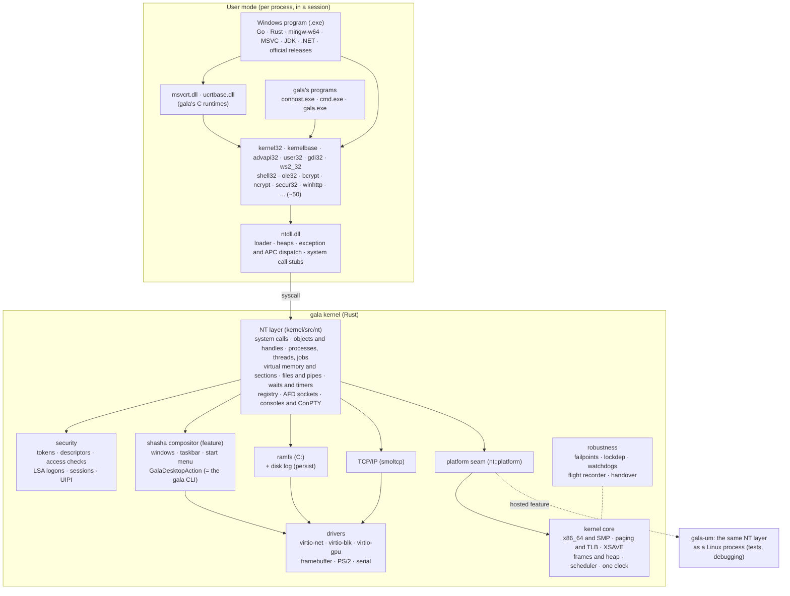

### Booting

```mermaid
flowchart LR
    fw["BIOS or UEFI<br/>(CD, disk or USB stick)"] --> limine["Limine<br/>kernel + boot modules<br/>+ command line"]
    limine --> init["kernel init<br/>GDT/IDT · memory map · paging · heap<br/>clock calibration · all CPUs (MADT)"]
    init --> drv["drivers<br/>virtio-net · virtio-blk · display"]
    drv --> fsinit["C: in memory<br/>boot modules under C:\gala,<br/>DLLs under C:\Windows\System32,<br/>registry seeded, user profiles"]
    fsinit --> persist{"persist?"}
    persist -- yes --> replay["replay the disk log<br/>(files and registry)"]
    persist -- no --> run
    replay --> run["start= servers, then<br/>run=a.exe,b.exe<br/>(as=system, restart=)"]
    run --> log["serial port + screen:<br/>output, ledger, nt: and stats: lines,<br/>gala: boot ok"]
    log -. "handover=n" .-> handover["hand over to a new kernel"]
```

### Starting a process

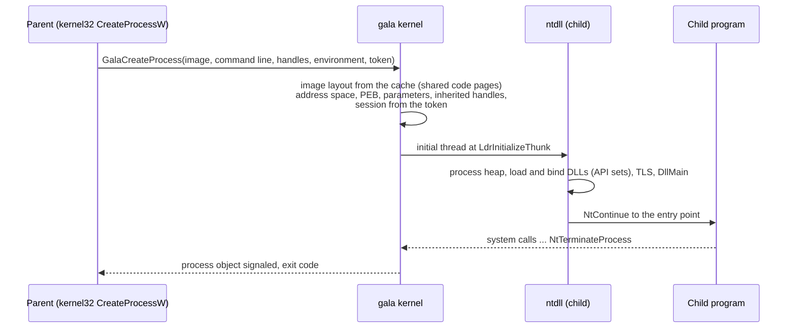

### A system call

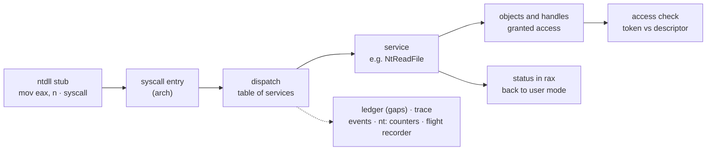

### Security and logons

How a login over SSH becomes a process with its own token (SECURITY.md):

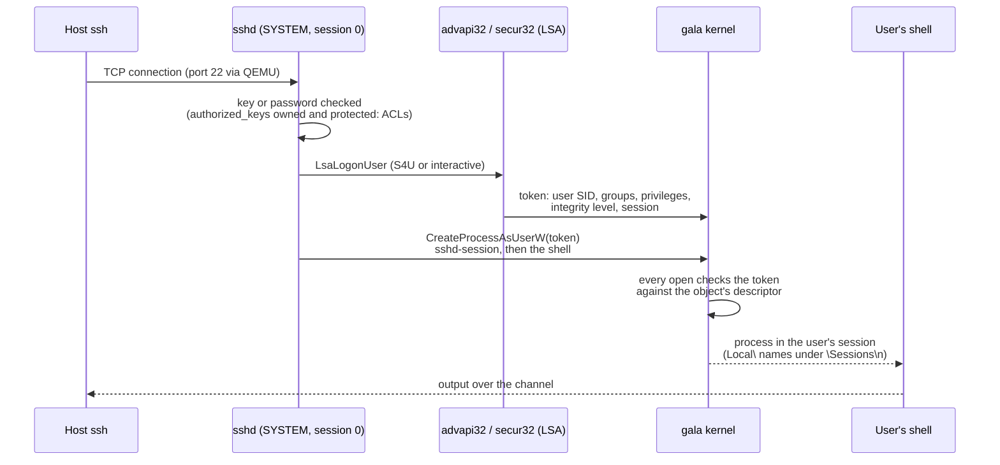

### Consoles and remote shells

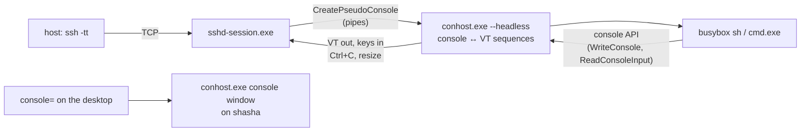

### Networking

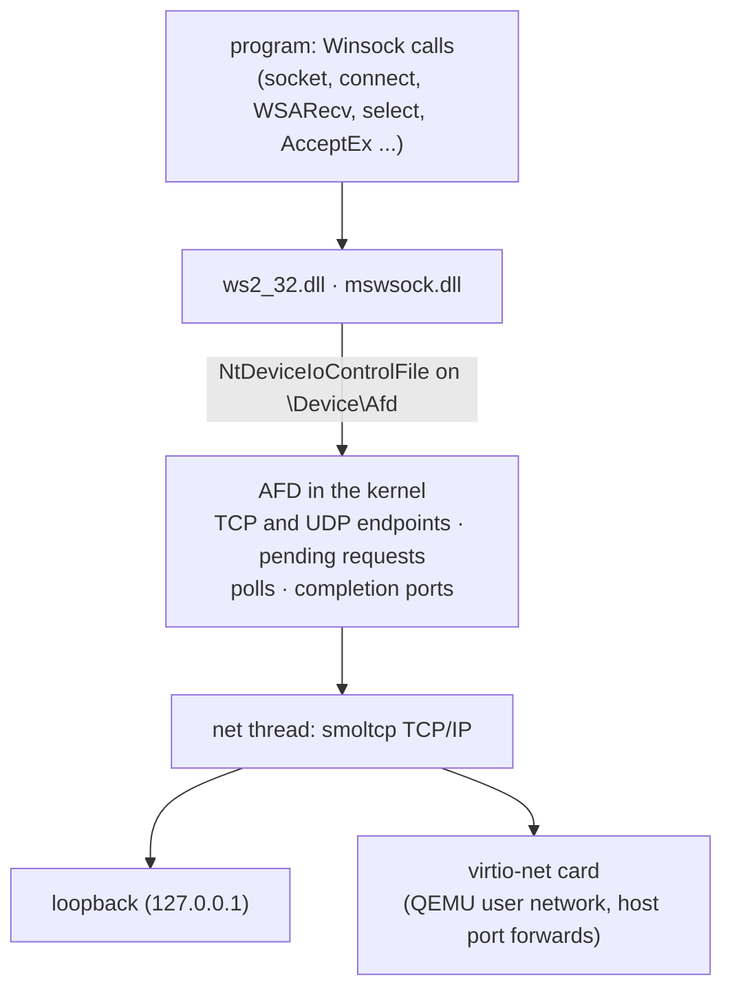

### The desktop and the command line

Every desktop action goes through one kernel entry point, so the `gala`
command can do anything the mouse can (ROADMAP SD):

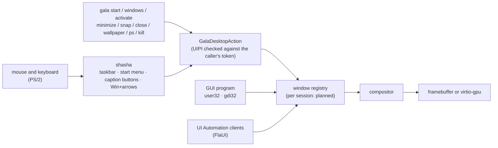

### C: kept on the disk

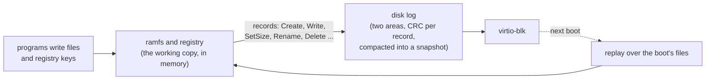

### Kernel handover (toward live update)

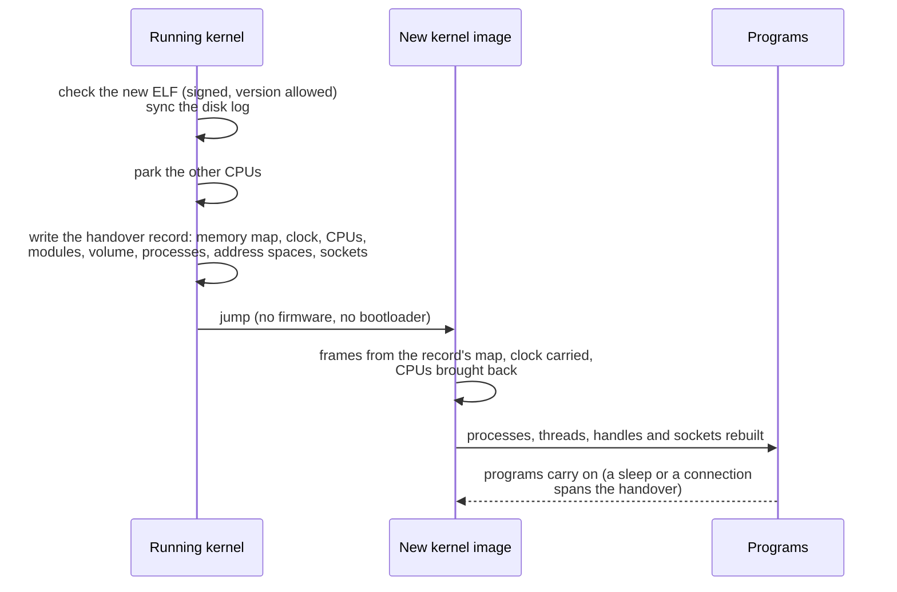

### Building on gala

The self-hosting scenarios chain real tools, each running as Windows
programs on gala:

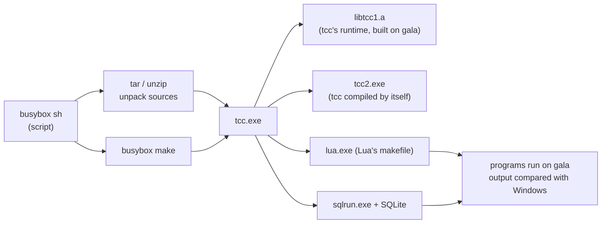

### Testing and troubleshooting

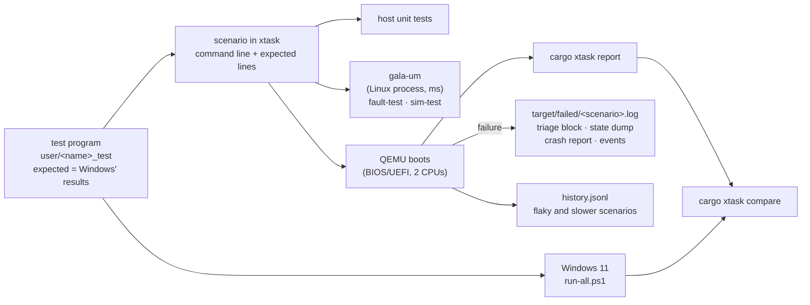

## Repository layout

| Path | What it holds |
|---|---|
| `kernel/` | the kernel: `arch` (x86_64, SMP, paging, virtio), `boot`, `mm`, `sched`, `fs` (ramfs, disk log), `disk` (virtio-blk), `net` (virtio-net, smoltcp), `display` (framebuffer, virtio-gpu), `nt` (the NT system call layer, security, registry, desktop), `lx` (the Linux personality), `handover` (kernel handover), `trust` (signed updates), `hosted` (gala-um's platform) |
| `kernel/lx_abi/` | Linux ABI data (signal numbers, struct layouts), host-tested |
| `user/<dll>/` | gala's DLLs: `testntdll` (ntdll), `kernel32`, `kernelbase`, `msvcrt`, `advapi32`, `user32`, `gdi32`, `ws2_32`, `shell32`, `ole32`, ... |
| `user/conhost`, `user/cmd`, `user/gala`, `user/galapkg` | gala's own programs: the console host, cmd.exe, the `gala` command, `gala install` |
| `user/<name>_test/` | Windows test programs (Rust on `user/ntrt` or kernel32; some C and C#) |
| `user/lx/` | Linux test programs and their expected (real Linux) transcripts |
| `user/go_*`, `user/nginx`, `user/busybox`, `user/tcc`, `user/lua`, `user/sqlite`, `user/java`, `user/postgres`, `user/sshd`, ... | real programs: build scripts, test scripts, configuration, data |
| `user/bin/` | the checked-in binaries (and `run-all.ps1` for Windows) |
| `um/` | gala-um, the NT layer as a Linux process |
| `xtask/` | the build and test driver (`cargo xtask ...`) and the scenarios |
| `docker/` | the Docker image for running the tests anywhere |
| `fonts/`, `vendor/` | the fonts the screen uses; vendored, patched crates (`smoltcp`, `getrandom`) |
| `docs/` | the documentation (see [Documentation](#documentation)) |

## Contributing

Issues, questions and discussion are welcome. Pull requests are not
accepted for now: without a license, contributed code would have no clear
terms.

## License

Copyright (c) 2026 Björn Ali Göransson. No license is granted (see
[`LICENSE`](LICENSE)). The source code is published so that people can
read it and follow the project, but all rights are reserved: publishing it
does not give permission to use, copy, modify or redistribute it (GitHub's
terms of service still allow viewing and forking on GitHub itself). The
`license = "LicenseRef-Proprietary"` in `Cargo.toml` means the same thing.

Third-party components in this repository (the programs under `user/bin`
built from third-party source, and the crates gala links) keep their own
licenses; [`THIRD_PARTY.md`](THIRD_PARTY.md) lists each one with its source.
